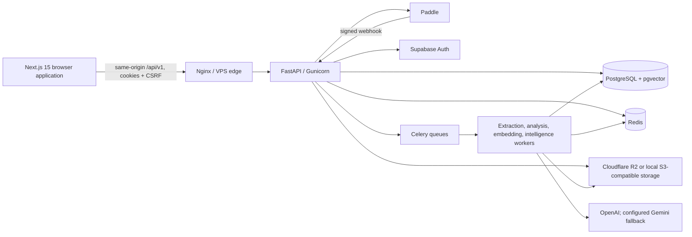

# LoreVia Architecture

Last reviewed: 2026-08-13

## System context

## Frontend

The frontend is a React 19 application on Next.js 15's App Router. Protected dashboard and reader surfaces are primarily client-rendered. Axios sends credentialed requests through the same-origin `/api/v1` path, which Next rewrites to the API origin. TanStack Query owns server state and Zustand owns authentication, reader preferences, and book-mode UI state. Supabase provides the OAuth PKCE client flow; LoreVia's backend remains the application-session authority.

The application supports offline manuscript recovery through IndexedDB and smaller browser-local drafts/preferences through `localStorage`. User-authored browser persistence is security-sensitive and must be namespaced by the authenticated user as well as the resource identifier.

## API and application layers

`backend/app/main.py` creates the FastAPI application, middleware, request IDs, structured error responses, CORS/trusted-host controls, Sentry integration, and liveness/readiness endpoints. `backend/app/api/v1/router.py` composes public, authenticated, billing, webhook, administration, and product routers.

Endpoint handlers live in `backend/app/api/v1/routes/`. Multi-step and transactional workflows live in `backend/app/services/`; reusable domain logic lives in `backend/app/utils/`. Pydantic schemas are in `backend/app/schemas/`, and SQLAlchemy models are in `backend/app/models/`.

## Authentication, authorization, and tenant boundaries

LoreVia issues short-lived signed access JWTs and refresh JWTs in HttpOnly cookies. Unsafe cookie-authenticated requests require a matching readable CSRF cookie/header pair and an allowed origin. Refresh-session state, one-time capabilities, rate-limit counters, and administrator step-up state use Redis. Supabase identity tokens are verified server-side before being linked to a LoreVia user.

The primary tenant boundary is `Book.user_id`. Most book access is routed through `backend/app/utils/books/collaboration_access.py`, which returns either the owner context or an active collaborator and applies chapter/scope permissions. World-building data is owner-only unless explicitly shared. Public and guest features use narrowly scoped signed capabilities. Every dependent object lookup must validate its parent book; possession of an object UUID is never authorization.

## Data layer

SQLAlchemy 2.x async sessions connect to PostgreSQL through `asyncpg`. PostgreSQL stores accounts, subscriptions, books, chapters and versions, collaborators, reading progress, characters and relationships, continuity/advisor results, public/social data, and durable task-control records. Foreign keys generally cascade book/user deletion to owned data.

`pgvector` stores 1,536-dimension book-chunk and character embeddings. Book chunks have a book/chunk index and an HNSW cosine index. Semantic queries must always apply the authorized book boundary and spoiler/chapter boundary before returning text.

Alembic history lives under `backend/app/db/migrations/`. Migration validation runs in CI against an isolated pgvector database. Production migrations are part of the explicitly approved VPS release procedure, not an automatic branch-push workflow.

## Storage and ingestion

`backend/app/core/storage.py` abstracts Cloudflare R2/S3 and local filesystem storage. Object keys are validated against absolute paths and traversal. Upload routes bound reads and validate document signatures and archive expansion before parsing. Manuscript source files, chapter payloads, covers, chapter media, exports, and privacy archives flow through this layer.

The local `file://` mode is intended for local development with a shared named volume. Production is expected to use durable R2-compatible storage unless a durable, shared VPS mount is explicitly provisioned.

## Background processing

Redis is the Celery broker. Dedicated workers consume extraction, analysis, embedding, and intelligence queues; Celery Beat schedules maintenance. Tasks use late acknowledgement, worker-loss rejection, prefetch of one, bounded process recycling, queue-specific time limits, and bounded retries.

PostgreSQL `BookProcessingRun`, `TaskExecution`, and `TaskDispatchOutbox` records are the durable control plane for core processing. Database row locks and execution identities prevent concurrent claims; Redis markers are advisory accelerators and must not be required to preserve a committed task state. Task code must be replay-safe because late acknowledgement permits redelivery.

## LLM, embeddings, and RAG

Extraction parses a manuscript, creates chapter chunks, generates embeddings, resolves character identities/relationships, and dispatches chapter analysis. Reader search and advisor features retrieve book-scoped chunks with spoiler gates, then construct prompts for OpenAI. LLM control services reserve and record usage and apply configured retry/cost limits; Redis caches embeddings and selected derived answers.

Prompts and retrieved text are untrusted content. Model output is parsed and validated before persistence, and model text is never treated as authorization, executable instructions, or trusted HTML. Fallback providers must use the same timeout, usage accounting, rate-limit, and observability path as the primary provider.

## Billing

Authenticated billing endpoints create Paddle checkout/portal requests and return signed confirmation capabilities. `/api/v1/webhooks/paddle` verifies the timestamped HMAC over the exact raw body before parsing. `PaddleWebhookEvent` records deduplicate deliveries, while subscription and user-tier changes are applied in a database transaction. Provider event ordering and crash-safe processing leases remain important invariants for future hardening.

## Caching and rate limiting

Redis caches are derived data with explicit TTLs and domain-specific invalidation helpers. Authentication/session state and abuse controls are not interchangeable with best-effort caches. The frontend query cache is cleared at account boundaries. API, authentication, public asset, and LLM-intensive routes use distinct limiters; outage behavior should be chosen by endpoint risk rather than applied globally.

## Observability

The API installs request IDs, structured logging, sanitized validation/500 responses, and Sentry scrubbing. Request IDs propagate into Celery task headers and are installed in worker execution context. Nginx logs upstream timing, containers use bounded log rotation, and `/health` plus `/ready` expose process, schema/vector, database, and Redis readiness.

Frontend product analytics are consent-gated through PostHog. Browser exception and Web Vitals telemetry are not yet equivalent to backend observability.

## Deployment

The tracked VPS stack contains Nginx, FastAPI, Redis with AOF, four Celery worker roles, Beat, and optional Flower. The API and worker runtime drop to a fixed unprivileged service user. `deploy.sh` performs the VPS release sequence, including backup/migration safeguards and health checks. Read-only production probes on 2026-09-06 confirmed that the frontend is hosted by Vercel at `www.getlorevia.com` and its same-origin `/api/v1` rewrite reaches the Cloudflare-fronted VPS API. The Vercel production-branch setting, same-commit promotion procedure, and rollback ownership remain external deployment state and must be verified for each coordinated release.

## Non-negotiable invariants

1. Every private object lookup is authorized through its owning user/book and collaboration scope.
2. Browser, Redis, and CDN caches never cross an authenticated-user boundary.
3. Webhooks are size-bounded, signature-verified over raw bytes, idempotent, and order-aware.
4. Retried tasks cannot expose partial state, duplicate billable work, or replace a terminal execution result.
5. External calls have finite timeouts and do not block the async event loop.
6. Production schema changes are reviewed, backed up, serialized with the matching release, and never inferred from ambient configuration.
